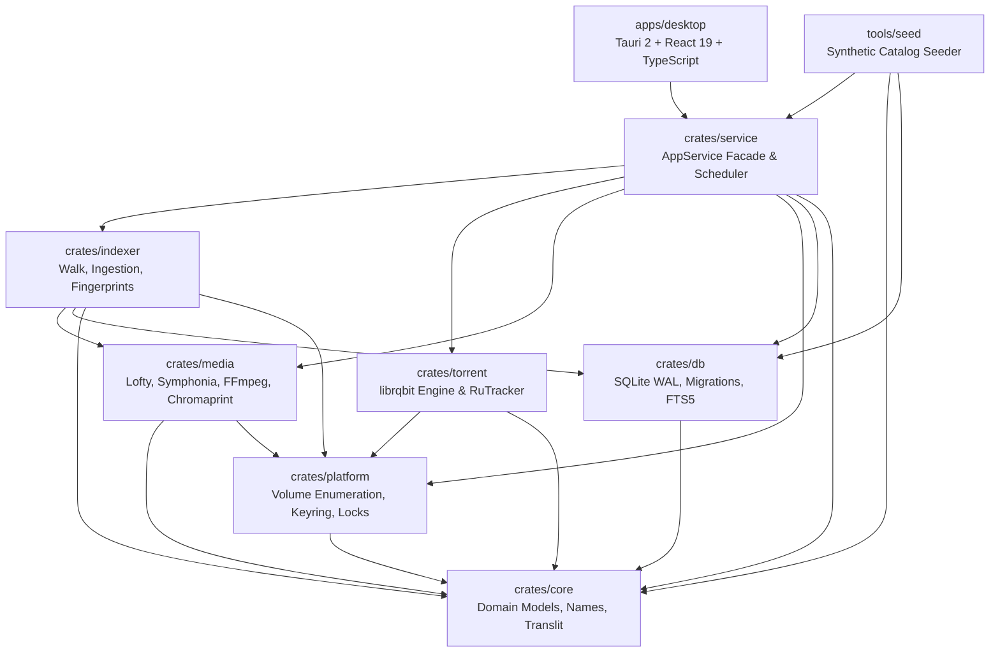
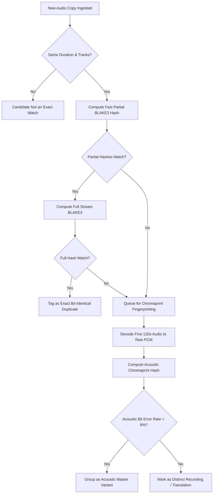

# AudioVault — Architecture Specification

AudioVault is a local-first, cross-platform desktop application built with Rust, Tauri 2, and React 19 for managing, cataloging, deduplicating, optimizing, and acquiring large audiobook and e-book collections across online and offline storage media.

---

## 1. High-Level System Architecture

The following diagram illustrates the dependency flow and operational relationships between the crates in the workspace:



---

## 2. Workspace Crate Taxonomy & Responsibilities

| Crate | Responsibilities | Key Dependencies |
| :--- | :--- | :--- |
| **`crates/core`** | Fundamental domain models (`Book`, `AudioCopy`, `Track`, `Volume`, `FileOpRecord`), Cyrillic normalization & beam transliteration, Russian name parsing (`Фамилия И.О.`, `Имя Отчество Фамилия`), bitrate/duration quality scoring, path safety checks (`is_path_safe`), audio transcode policy definitions. | `serde`, `chrono`, `uuid`, `unicode-normalization`, `regex` |
| **`crates/db`** | SQLite persistence layer with Write-Ahead Logging (`WAL`), multi-threaded connection management, schema migration engine (`0001_initial.sql`, `0002_fingerprints_optimizer.sql`, `0003_media_tags.sql`), FTS5 transliterated search queries, duplicate matching queries, file operation journal records. | `rusqlite` (with `bundled`, `fallible_uint`), `parking_lot`, `tracing` |
| **`crates/platform`** | OS integration primitives: hardware volume serials and UUIDs, `.audiovault-id` marker files, storage bus type detection (NVMe/SSD vs HDD/USB), OS Credential Manager/Keyring integration, process sleep inhibition during scans/transcodes (`SetThreadExecutionState`), single-instance application locking. | `windows-sys`, `dirs`, `tracing` |
| **`crates/media`** | Audio probing and format inspection (MP3, M4B, M4A, FLAC, OGG, OPUS, AAC), FB2 metadata XML parser (`quick-xml`), embedded cover art extraction (ID3v2 APIC, Vorbis/MP4 art), Chromaprint acoustic fingerprint calculation, BLAKE3 chunked stream hashing, FFmpeg transcode & repack plan execution. | `lofty`, `symphonia`, `quick-xml`, `blake3`, `rusty-chromaprint`, `image` |
| **`crates/indexer`** | Multi-phase directory walker, audio set grouping, file change detection via mtime and partial BLAKE3 hashes, full acoustic fingerprint computation queue, cross-volume duplicate correlation across blocking keys. | `crossbeam-channel`, `audiovault-core`, `audiovault-db`, `audiovault-media` |
| **`crates/torrent`** | Embedded `librqbit 9.0` session wrapper, background download manager, RuTracker HTTP client with CP1251 encoding/decoding, HTML table scraping, rate limiting, CAPTCHA detection, OS keyring integration for credentials. | `librqbit`, `reqwest`, `scraper`, `tokio` |
| **`crates/service`** | Central orchestration facade (`AppService`), concurrency-managed scheduler with separate HDD and SSD I/O budgets, volume discovery and hotplug monitor, crash-resilient journaled file operations engine, decoupled reactive `EventBus`. | `tokio`, `parking_lot`, `trash`, `audiovault-*` |
| **`apps/desktop`** | Tauri 2.x desktop application shell (`src-tauri`) paired with a React 19 + TypeScript + Lucide modern frontend (`src`). Clean information density, virtualized library, drawer inspector, real-time event updates. | `tauri 2`, `react 19`, `typescript`, `vite`, `lucide-react` |
| **`tools/inspect`** | Direct diagnostic CLI for inspecting local SQLite catalogs, volumes, background tasks, and duplicate candidate pairs. | `audiovault-db`, `audiovault-platform`, `audiovault-indexer` |
| **`tools/seed`** | Standalone tool for populating realistic synthetic catalogs with multiple volumes, books, audio copies, and deliberate duplicates for offline volume and search validation. | `audiovault-db`, `audiovault-core` |

---

## 3. Database Design & Concurrency Strategy

### 3.1 SQLite WAL Mode Configuration
To achieve high-throughput concurrent indexing alongside responsive UI queries, `audiovault-db` configures SQLite connections with the following pragmas:
```sql
PRAGMA journal_mode = WAL;
PRAGMA synchronous = NORMAL;
PRAGMA foreign_keys = ON;
PRAGMA busy_timeout = 5000;
PRAGMA temp_store = MEMORY;
PRAGMA cache_size = -64000; -- 64MB cache
```

- **Connection Segregation**: Read-only queries (UI lists, search, duplicate inspectors) utilize dedicated read-only connections without blocking the background indexing or transcode worker threads.
- **Write Serialization**: Write operations (scans, ingestion, file operation journals) pass through transactional write blocks protected by SQLite's WAL coordinator and application-level locks.

### 3.2 Full-Text Search (FTS5) & Cyrillic Transliteration
Russian book titles, author names, and narrator names frequently exist in mixed transliterations (e.g., `Борис Акунин` vs `Boris Akunin`, `Лукьяненко` vs `Lukyanenko`). 

The search subsystem uses a dual-representation indexing strategy:
1. Every string field inserted into `books_fts` stores both the normalized original form and its phonetic transliterated representation generated via `audiovault_core::translit::transliterate_cyrillic_to_latin`.
2. Search queries pass through identical transliteration pipelines. A search query entered in Cyrillic (`фандорин`) or Latin (`fandorin`) matches records regardless of how the physical ID3 tags or folder names were encoded.

---

## 4. Storage Architecture & Volume Identification

Audio collections typically span internal NVMe drives, external USB desktop HDDs, and portable flash drives. AudioVault handles drive disconnection and drive letter changes gracefully.

### 4.1 Persistent Volume Markers (`.audiovault-id`)
Operating system drive letters on Windows (`D:`, `E:`, `F:`) are volatile and change between reboots. To maintain persistent volume identity:
1. When a volume is registered in AudioVault, a hidden marker file `.audiovault-id` is written to the volume root containing a JSON payload:
   ```json
   {
     "volume_id": "7f8b91a2-4c2d-4e89-a1b2-c3d4e5f60718",
     "created_at": "2026-10-12T10:00:00Z",
     "display_name": "Seagate Backup Plus"
   }
   ```
2. Hardware serial numbers (via Windows `GetVolumeInformationW`, macOS `statfs`, or Linux `/proc/mounts`) serve as a secondary identifier if the file system is read-only.
3. All file paths stored in the database are stored as **relative paths** to the volume root (e.g., `Audiobooks/Fiction/Author/Book`). Absolute paths are re-computed dynamically at runtime:
   $$\text{Absolute Path} = \text{Volume Mount Path} + \text{Relative Path}$$

### 4.2 Offline Volumes & Ghost Catalog
When an external drive is unmounted:
- `audiovault-platform::volume::VolumeMonitor` detects the disconnection event within 2.5 seconds.
- The database flags the volume as `is_online = FALSE`.
- The user can still search, browse, view chapters, read FB2 descriptions, and review acoustic duplicates for offline books.
- Attempting to play, transcode, or relocate an offline copy presents a friendly prompt identifying the exact physical drive name that needs to be connected.

---

## 5. Deduplication & Audio Verification Pipeline

Deduplication occurs in three progressive tiers to balance computational cost and acoustic precision:



### 5.1 Tier 1: Fast BLAKE3 Stream Hashes
- **Partial Hash**: Hashes the first 64KB, middle 64KB, and last 64KB of the media file. Eliminates 98% of non-matching files instantly without reading multi-gigabyte files.
- **Full Hash**: Streamed through a BLAKE3 incremental hasher in 128KB chunks with zero dynamic heap allocation in the hot loop.

### 5.2 Tier 2: Chromaprint Acoustic Fingerprinting
Audiobooks are often re-encoded (e.g., converted from FLAC to MP3 128kbps, or re-tagged with different ID3 artwork), which destroys byte-level hash matches despite containing the identical vocal performance.
- AudioVault uses `audiovault-media::fingerprint::compute_fingerprint` to decode the first 120 seconds of audio via `symphonia` into 16-bit 11025Hz mono PCM.
- `rusty-chromaprint` extracts the 32-bit acoustic fingerprint vector.
- Bit-wise cross-correlation and population count Hamming distance evaluate similarity:
  $$\text{Similarity}(\mathbf{A}, \mathbf{B}) = 1.0 - \frac{\text{HammingDistance}(\mathbf{A}, \mathbf{B})}{\text{TotalBits}}$$
- Any pair with $\text{Similarity} \ge 0.92$ is correlated as an audio performance duplicate.

### 5.3 Quality Scoring Engine
When duplicates are discovered, `audiovault-core::quality::score_audio_copy` scores each variant using:
- Format preference: FLAC/ALAC (+100) > M4B (+80) > MP3 320kbps (+60) > MP3 192kbps (+40) > MP3 128kbps (+20) > 64kbps (0).
- Structure: Single-file M4B with embedded chapter marks (+25).
- Metadata completeness: ID3v2 title, author, narrator, year, and cover art (+5 each).

The copy with the highest score is recommended as the **Keeper**, while lower-quality variants are suggested for relocation or safe recycling.

---

## 6. Concurrency & I/O Scheduling Architecture

Audiobook operations involve large file read/writes. Running concurrent parallel file operations on rotational hard drives (HDDs) causes extreme head thrashing, dropping throughput from 180 MB/s to under 15 MB/s.

`audiovault-service::scheduler::IoScheduler` enforces **Hardware-Aware I/O Budgeting**:

```rust
pub enum StorageClass {
    /// NVMe / SATA Solid State Drive (High IOPS, parallel execution allowed)
    Ssd,
    /// Rotational Magnetic HDD / USB 2.0/3.0 (Low random IOPS, serial execution mandatory)
    RotationalHdd,
    /// Unknown / Remote Network Mount (Conservative serialized execution)
    NetworkOrUnknown,
}
```

- **Rotational Drives**: Operations targeting the same physical volume are assigned to a single-threaded FIFO work queue (concurrency = 1).
- **Solid State Drives**: Operations run concurrently up to $N = \min(\text{CPU cores}, 4)$.
- **Transcode Throttling**: CPU-bound transcode jobs run at `ThreadPriority::Lowest` to ensure the Slint GUI remains responsive at 60 FPS.

---

## 7. Crash Recovery & Journaled File Operations

All file moves, consolidations, and deletions follow an atomic **Two-Phase Journaling Protocol** implemented in `audiovault-service::fileops::FileOperationEngine`:

1. **Plan & Validation**:
   - Verify source path exists and destination volume has sufficient free space.
   - Compute destination path sanitization (stripping illegal Windows/FAT characters: `< > : " / \ | ? *`).
2. **Journal Write**:
   - Write a `FileOpRecord` to the SQLite `file_operations` table with status `Planned`.
   - Write a fallback disk journal file `.audiovault-op.json` in the destination directory.
3. **Execution**:
   - For moves across the same volume: atomic file system rename (`std::fs::rename`).
   - For moves across separate volumes: stream copy with verification of byte count and BLAKE3 hash before deleting the source.
   - For deletions: dispatch to system recycle bin via `trash::delete` by default, only performing hard unlinks (`std::fs::remove_file`) if the user explicitly checked "Permanent Deletion".
4. **Commit / Rollback**:
   - Upon successful verification, the database transaction commits the updated copy path, marks the operation as `Committed`, and removes `.audiovault-op.json`.
   - On application startup, `FileOperationEngine::recover_pending_operations` scans for `Planned` records or orphan `.audiovault-op.json` files and executes rollback or prompts the user for resumption.

---

## 8. Embedded Torrent Engine & Security Architecture

### 8.1 Engine Lifecycle (`librqbit 9.0`)
Audio acquisitions integrate `librqbit` directly into the process space without requiring an external daemon (like qBittorrent or Transmission).
- Listens on a dedicated randomized local port.
- Configures DHT, TCP, and uTP transport.
- Download progress, peer statistics, and upload limits are exposed directly to the Slint UI via `audiovault-torrent::TorrentEngine`.

### 8.2 RuTracker Integration & Credential Security
- **Credential Storage**: RuTracker credentials (username and password) are **never** stored in plain text or in the SQLite database. They are securely saved in the native operating system credential store via `keyring` (Windows Credential Manager, macOS Keychain, Linux Secret Service).
- **Encoding Compliance**: RuTracker search forms require CP1251 (`windows-1251`) form data encoding. AudioVault automatically encodes Cyrillic search queries into CP1251 byte sequences and decodes the response HTML using `encoding_rs`.
- **CAPTCHA & Rate Limiting**: Scraper requests enforce a minimum inter-request delay (1.2s) and detect login CAPTCHA challenges or session expirations, prompting the user through the Slint UI.

---

## 9. Desktop Shell & Reactive IPC Architecture

AudioVault’s user interface is built on **Tauri 2** (`apps/desktop/src-tauri`) with a modern **React 19 + TypeScript** frontend (`apps/desktop/src`).

### 9.1 Strongly-Typed Command IPC
Frontend-to-backend communication uses strictly typed Tauri commands (`invoke`), avoiding generic string passing or insecure shell execution:
- `get_library_books(filter, sort, search)`: Querying SQLite catalog with filtering and ordering.
- `search_books(query)`: High-performance SQLite FTS5 with phonetic/transliteration normalization.
- `get_book_details(bookId)`: Detailed book metadata, variant copies, and track lists.
- `get_volumes()`: Storage list with mount path, capacity, free space, and online/offline status.
- `add_storage_folder(path)` / `pick_folder()`: Safe folder registration and native folder picker.
- `scan_volume(volumeId)` / `scan_all()`: Background incremental traversal and audio set discovery.
- `get_duplicates()` / `find_all_duplicates()`: Chromaprint acoustic and metadata deduplication.
- `get_optimizations()` / `start_transcode(copyId)`: FFmpeg repack and M4B join engine.
- `get_cover_data(path)`: Efficient streaming of cached 256x256 JPEG artwork thumbnails.

### 9.2 Decoupled Reactive Event Dispatch
To ensure the UI is immediately informed when background operations make progress without polling, `AppService` emits asynchronous events forwarded via Tauri's event emitter (`app.emit`):
```rust
service.events().set_sink(move |event| {
    let ev_str = match event {
        AppEvent::VolumesChanged => "volumes_changed",
        AppEvent::LibraryChanged => "library_changed",
        AppEvent::DuplicatesChanged => "duplicates_changed",
        AppEvent::IssuesChanged => "issues_changed",
        AppEvent::JobsChanged => "jobs_changed",
        AppEvent::TorrentsChanged => "torrents_changed",
        _ => "notice",
    };
    let _ = handle.emit("app_event", ev_str);
});
```
The React application subscribes using `@tauri-apps/api/event` and automatically reloads relevant state upon event arrival.

This guarantees that:
1. Long-running disk scans, hashing, and transcodes never block the UI thread.
2. The UI renders at full 60–144 Hz display refresh rates with instant user feedback.
3. Offline disks and live disk connections update dynamically in real time.
